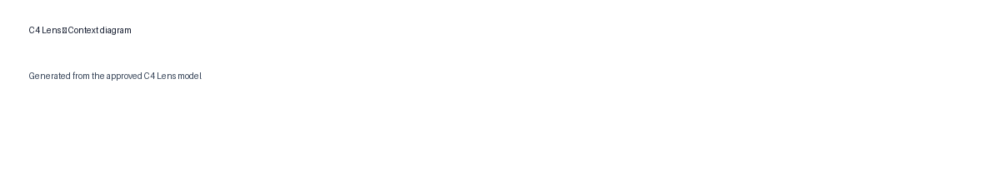

# C4 Lens

C4 Lens turns a software problem statement into a reviewable C4 System Context and Container model. It keeps stated facts, derived structure, and proposed assumptions distinct until a person decides what to accept or reject.



## V1 capabilities

- Structured, Pydantic-validated C4 model
- Deterministic hierarchy, relationship, provenance, and approval checks
- Explicit Accept/Reject review for proposed architecture
- System Context and Container diagrams from one canonical model
- SVG, PNG, and JSON exports after approval
- Native SVG pictograms in diagrams and exports

## Architecture

Streamlit provides the session-only UI. One Vercel AI Gateway call proposes structured output; Python/Pydantic validates it; Graphviz and the final SVG pipeline render the views. The human approval gate separates an unreviewed draft from the canonical exportable model.

## Run locally

```bash
python -m venv .venv
source .venv/bin/activate
pip install -r requirements.txt
streamlit run app.py
```

Set `AI_GATEWAY_API_KEY` for live generation. `AI_GATEWAY_MODEL` is optional and defaults to `openai/gpt-5.6-terra`. Keep credentials in local or deployment secret configuration only; never commit them.

## Quality and deployment

Run `ruff check .` and `pytest -q`; CI also runs an import smoke check. The deployed Streamlit Community Cloud demo uses Vercel AI Gateway:

- Demo: https://c4-lens-rbpydsvxyvzbywl4subniy.streamlit.app/
- Repository: https://github.com/lulu3202/c4-lens

## Documentation

The lifecycle record runs from [Intent](docs/01-intent.md) through [Product Assurance](docs/07-product-assurance.md) and [Learnings](docs/08-learnings.md). Article drafts are in [`articles/`](articles/).

## Known limitations

Wide Container diagrams may look compressed in Streamlit's half-width column, although natural-size exports remain usable. Model extraction is probabilistic and must be reviewed; one live tutor run classified people as external. C4 Simon was unavailable, so V1 uses deterministic C4 rule validation.

C4 Lens is independent software. It is not affiliated with Structurizr or the C4 Model authors, and it does not claim official C4 compliance.
