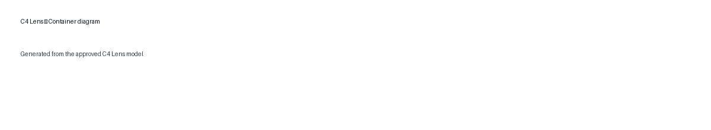

# I Used My Lightweight AI-Native SDLC to Build C4 Lens

*Part 2 of 2*

C4 Lens began as a deliberately narrow V1: take a software problem statement, propose a C4 architecture, make uncertainty reviewable, then render System Context and Container diagrams that can be exported. The intent was not “AI architecture automation.” It was to see whether an LLM could be useful without allowing its output to become unreviewed architecture truth.

This is the practical test of the lightweight lifecycle from Part 1. The project moved from intent to a deployed release candidate in a small number of artifacts, but it did not get a free pass from evidence. In fact, the most useful discoveries arrived after the code looked finished.

## 1. Intent: constrain V1 before the agent expands it

The V1 journey was: **problem statement → proposed architecture → human review → Context + Container → export**. That immediately excluded a catalog of tempting features: accounts, persistence, collaboration, history, a general-purpose diagram editor, a component view, and a bespoke architecture repository. The narrowness was productive. A coding agent can generate any of those starting points; intent gave us a way to reject them without treating rejection as failure.

## 2. Context: identify the real boundary

The first Context was intentionally sparse: a reviewer, C4 Lens, and an external LLM boundary. That boundary was more useful than a premature list of servers. It clarified that the application had to protect a human decision between a provider’s proposal and any canonical diagram.

The entry point is intentionally small: one problem statement starts a draft; it does not claim to produce an approved architecture.

## 3. Product Behavior: make review the central interaction

The behavior became: describe the system, inspect a draft, inspect provenance, explicitly Accept or Reject proposals, approve the resolved model, visualize it, and export it. This was not a UX embellishment. It is the product’s argument about authority.

Stated elements are what the problem statement supplied. Derived elements are only logical structure that follows from them. Greenfield runtime elements are proposed assumptions. The visual review is necessary because a clean JSON parse is not evidence that a proposed data store, worker, or integration is true.

The resulting review surface makes that burden visible: the proposed model is a decision aid, not a silent hand-off from the model to the diagram.

## 4. Architecture Review Pack: choose the minimum shape

The review pack settled on Streamlit, Python, Pydantic, Graphviz, and one LLM provider adapter. Streamlit provided an intentionally small session-only UI. Pydantic owned structured-model validation. Graphviz handled graph layout, while a final SVG pipeline controlled exportable presentation. The provider adapter was deliberately narrow so deterministic checks and tests did not inherit provider behavior.

Several options were consciously rejected: a database, FastAPI, React, LangGraph, a Structurizr runtime, and microservices. None was required to prove the V1 journey. Their absence is not a claim that they are bad tools; it is evidence that architecture followed behavior rather than a generic “production stack” template.

## 5. Build Contract: proposal, validation, approval

The Build Contract was short: the LLM proposes; deterministic code validates; the human approves. That rule affected the schema, UI, and exports. One Pydantic-backed C4 model supplies both Context and Container views. Deterministic code checks unique IDs, relationship endpoints, hierarchy, provenance, and view validity. Approval is unavailable while proposals remain unresolved. Exports are gated behind that approval.

The rule had a practical consequence for greenfield prompts. A user normally describes outcomes, not a runtime architecture. The model should preserve stated people and systems, derive only what is entailed, and propose a minimal container structure where needed. Those proposed containers must remain assumptions until reviewed. The result is not an assertion that a web app, service layer, data store, or worker exists; it is a transparent candidate worth discussing.

## 6. Plan + Proof: decide evidence before the UI looks convincing

Before implementation, the proof cases covered invalid relationship endpoints, duplicate IDs, hierarchy errors, unresolved approvals, export gating, and deterministic end-to-end flows. The live cases added a greenfield tutor scheduling SaaS, a simple business/CRUD case, and a system with external integrations. Those cases were useful because they placed different pressure on provenance and container proposal.

The final suite has **12 tests**. The Vercel AI Gateway boundary is mocked in tests, keeping CI independent of live credentials. Lint, tests, and an import/compile smoke check started with the runnable slice rather than becoming a release-week task.

## 7. Build + CI: keep the provider a boundary, not an environment dependency

The deployed application uses Vercel AI Gateway, with `openai/gpt-5.6-terra` as the configured default model. Its structured output flows into Pydantic validation rather than directly into rendering. This gives the model a constrained role: it can propose a model in a defined shape, but it cannot bypass deterministic rules or human review.

That separation mattered operationally. Local and CI checks exercised the contract without reading any credential. The release candidate exercised the live provider. The two forms of evidence answer different questions and neither is a substitute for the other.

## 8. Release Candidate: use the deployed app, not the memory of it

The release candidate was deployed to Streamlit Community Cloud and connected to Vercel AI Gateway. The exact deployed build mattered more than expected. A stale Streamlit deployment briefly led to debugging the wrong renderer. The correction was process, not code: identify the running release candidate before explaining a visual defect.

This is a mundane lesson with teeth. A test result describes the code that ran. A screenshot describes the build the browser received. When those are not positively tied to the same release, even excellent debugging can be aimed at yesterday’s problem.

## 9. Product Assurance: the defects that changed V1

Product Assurance was the decisive stage. The initial generated tutor model had zero containers. The Container view could therefore become a Context view wearing a different tab label. That is not a minor layout defect; it breaks the promise of the product. The fix was not to invent facts. It was to teach greenfield extraction to propose a minimal plausible container architecture as `proposed_assumption`, require a review decision, and prohibit canonical Container export until reviewed containers exist.

Another defect was a generic approval action that effectively promoted proposals automatically. It was convenient but wrong: resolving an assumption is not the same thing as accepting it. The replacement requires an explicit Accept or Reject for each proposal. Rejected items disappear from the approved canonical model; accepted ones can appear in Container.

The renderer produced a third lesson. Native SVG pictograms existed in code and in unit-test markup, yet they did not initially appear in the deployed application. The problem was not solved by counting markup alone. Investigation required the actual Graphviz SVG, the final SVG pipeline, a local rasterization, the live browser display path, and exported files. A stale deployment amplified the confusion. The final evidence included positive identification of the deployed build, inspection of the actual output, and a Streamlit-native image display path using the same SVG that downloads use.

*Look for the system and external-system pictograms and the visual distinction between system boundary and surrounding actors.*

The fourth finding was visual rather than semantic. A wide Container diagram may be compressed in Streamlit’s half-width column even when the SVG itself is correct. Its natural-size export remains readable; V1 documents the in-app compression honestly rather than claiming it is solved.

## 10. Final result

The delivered V1 has a single canonical C4 model, provenance-aware review, deterministic validation, approval-gated JSON/SVG/PNG exports, and System Context plus Container views from the same model. The app is deployed and live gateway generation has been exercised.

*Use the exported diagram to inspect the reviewed runtime structure at natural size; it is the more reliable view when the application column compresses a wide graph.*

The live application is at https://c4-lens-rbpydsvxyvzbywl4subniy.streamlit.app/ and the source is at https://github.com/lulu3202/c4-lens.

There are documented limits. Extraction is probabilistic; in one tutor run, human actors were classified as external. That is an example of why the review gate remains fundamental. C4 Simon was unavailable in this environment, so V1 uses deterministic C4 hierarchy and rule validation instead. The project is independent software and does not claim official C4 compliance or affiliation.

## 11. What I learned

The process should be lightweight in artifacts but rigorous in evidence. Intent, Context, behavior, a compact review pack, a build contract, and proof cases were enough to make the important decisions visible. Extra documents would have added history, not confidence. At the same time, the final defects prove that “lightweight” cannot mean “unit tests are enough.”

The best evidence was often a real release-candidate interaction: a model with no containers, an approval control that made an unreviewed choice, an SVG that existed but did not paint, or an old deployment serving the wrong code. Those are exactly the failures a small lifecycle should preserve room to find. The outcome is not a claim that coding agents remove engineering judgment. It is a repeatable way to put their speed behind explicit decisions, deterministic checks, and a human reviewer.
