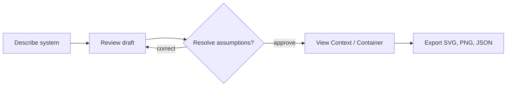

# Product Behavior

The user enters a problem, then sees stated facts, derived structure, and proposed assumptions. The draft banner remains until the user explicitly accepts or rejects every proposed item, or corrects it in JSON, and approves it. Invalid models show errors instead of renderable approved output. A failed live generation reports an error; no state is persisted beyond the browser session.
