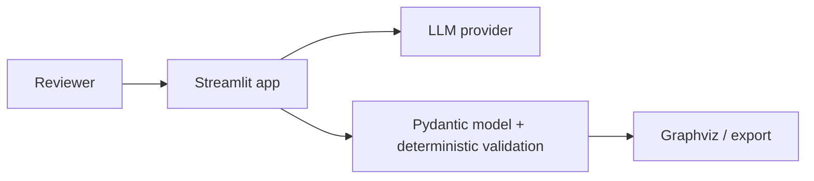

# Architecture Review Pack

| Decision | Status | Rationale |
|---|---|---|
| Streamlit monolith | Approved | one deployable unit for the V1 workflow |
| Pydantic canonical model | Approved | diagrams share one validated source of truth |
| Database/persistence | Rejected | session-only V1 has no retention need |
| FastAPI/React/microservices/LangGraph/Structurizr runtime | Rejected | unsupported complexity |

The LLM is an external trust boundary and proposes only structured data. The Streamlit session is the data authority and ends with the session. SVG is rendered from the canonical model; PNG and JSON export derive from it. A separate boundary contract is skipped: there is no independently deployable boundary that could drift.
